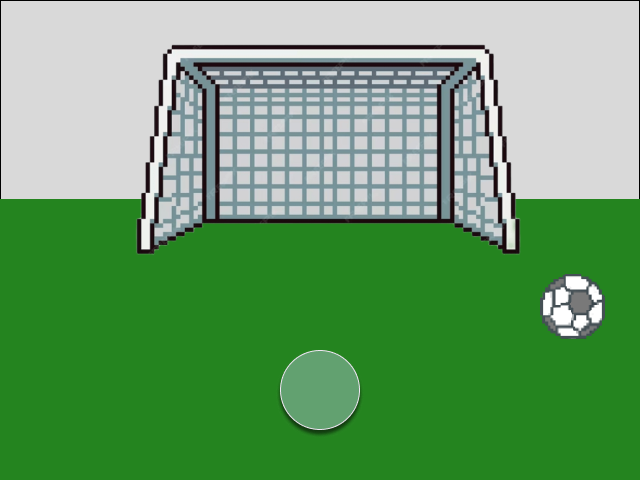
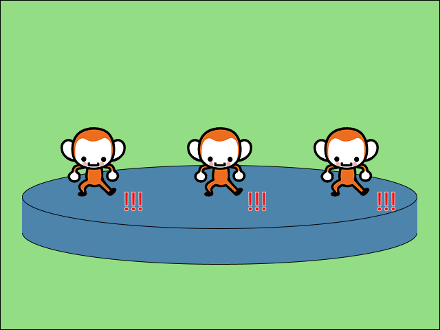

# Knees-Up

Knees-Up! es un juego rítmico interactivo creado para contribuir a la rehabilitación de la rodilla en niños atendidos por Coaniquem, utilizando la dinámica de un [Exergame](https://healthysd.gov/what-is-exergaming/) . El desarrollo del juego se realizó con el motor Godot, en su versión 4.4.1.

## Cómo instalar

Para jugar deben descargar el archivo ZIP del repositorio y descomprimirlo. Luego, abran el archivo `KneesUp.exe` en Windows.

## Controles

Para jugar, el usuario debe tener a disposición 2 Joy-Con de Nintendo Switch, los cuales deben estar conectados a la PC. El jugador deberá sostener un Joy-Con en cada rodilla y seguir las instrucciones que aparecen en pantalla para completar los niveles del juego.

## Diseño

El juego se basa en el estilo de la saga de videojuegos Rhythm Paradise, con variedad de niveles en donde el jugador deberá mover sus rodillas al ritmo de la música. Cada nivel presenta un desafío diferente, y el jugador debe seguir las instrucciones en pantalla para completar cada uno.

### Niveles

- **Nivel 1: Patear** : El jugador debe patear los penales al ritmo de la música.

  

- **Nivel 2: Pisar y Saltar** : El jugador debe copiar los movimientos de los monos en pantalla al ritmo de la música. Los posibles movimientos son: pisar y saltar.

  

Más niveles están en desarrollo y se agregarán en futuras actualizaciones.

## Créditos

Este juego fue desarrollado por [Gonzalo Cartes](https://github.com/Gon-Code) como tema de memoria para optar al título de Ingeniero Civil en Computación.
